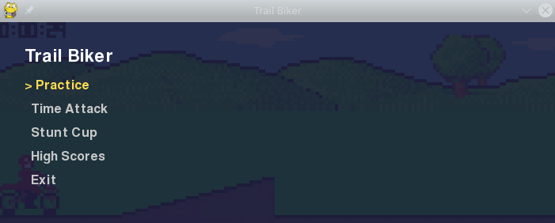
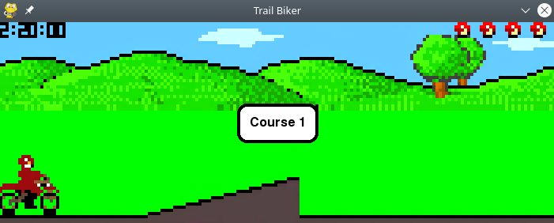

# Trail Biker Decomp

Decompilation and port of the [Trail Biker](https://www.youtube.com/watch?v=mjqeVeywQmE) mobile game from Nokia.

As the original black & white version from Nokia 2280 was firmware integrated, we've used the J2ME colored version from [Nokia 3410](https://www.butkaj.com/go/java/file.php?type=games&id=268).

## Port

The game was rewritten in Python + PyGame using the decompiled sources as base.

## Future Work

- upscale to FHD version
- menu settings, already in code but not used (i.e. sound on/off)
- level editor
- procedural levels
